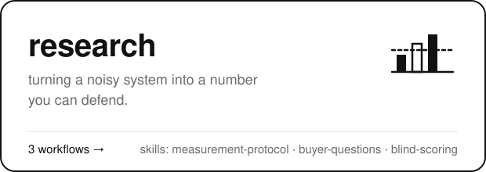

<a href="#the-workflows"></a>

## about

i'm shashank. online i sometimes go by stupidpreneur, and people describe me as an idiot savant.

i'm the co-founder of [ellora](https://getellora.com), the ai content editor inside chatgpt, claude and the other apps your team writes in. it learns how your brand sounds and fixes each draft before anyone has to.

most of my work is turning a messy job into a process that runs the same way twice. the job changes. the habit doesn't. i write down the steps, add a gate where things usually go wrong, and keep the evidence.

this repo is where those processes go once they've held up in real work. each workflow is one page with the exact steps, and one skill you can install in your own agent.

## the workflows

<p>
<a href="build/README.md"></a>
<a href="write/README.md"></a>
<a href="research/README.md"></a>
<a href="operate/README.md"></a>
<a href="presence/README.md"></a>
</p>

### [build](build/README.md)

shipping code with a coding agent, with a gate and evidence at every stage.

- **[most coding-agent failures are skipped stages](build/delivery-loop/README.md)**  
  the agent builds before anyone agreed on what to build, or says "tests pass" about an old commit. an eleven-stage loop where every gate leaves evidence. skill: `delivery-loop`
- **[a change can follow every standard and still be the wrong change](build/two-axis-review/README.md)**  
  you can't judge good code and right code in one review pass. you run a standards pass and a spec pass, and keep the reports apart. skill: `two-axis-review`

### [write](write/README.md)

writing with ai that still sounds like you, and gets checked before anyone reads it.

- **[stop telling writers to match the voice. measure it.](write/voice-profile/README.md)**  
  every team says "match our voice" and almost none can say what it means. turn the writing you've published into a profile you can check a draft against. skill: `voice-profile`
- **[ai can post for you every day, but only your answers can be the post](write/daily-posts/README.md)**  
  the bot asks, you answer, and two checked drafts come back. nothing gets scheduled without your letter for that exact draft. skill: `daily-posts`
- **[a video script that reads well can still fail when it is heard](write/video-script/README.md)**  
  write each product video as one argument a listener can follow. flow-read it the way it will be heard, fact-check it, show the approver a rough cut, and hand the builder one package. skill: `video-script`

### [research](research/README.md)

turning a noisy system into a number you can defend.

- **[the fastest way to fake progress is to change the measurement](research/measurement-protocol/README.md)**  
  add an engine or a few brand questions and the number goes up while the work stays the same. eight rules for measuring a system that moves while you measure it. skill: `measurement-protocol`
- **[a question set you brainstormed measures your team, not your buyers](research/buyer-questions/README.md)**  
  before you measure anything, build the questions from your buyers' own calls. check what assistants already answer, freeze the set, then map each question to the page that answers it. skill: `buyer-questions`
- **[if the scorer knows which text is the edit, the score is not a score](research/blind-scoring/README.md)**  
  an edit looks better when the scorer knows it's the edit. shuffle each run to neutral labels, keep the key apart, give every run a fresh scorer, and report each run and the mean. skill: `blind-scoring`

### [operate](operate/README.md)

the unglamorous fixes that keep a small business running.

- **[a broken link is a content bug with a customer attached](operate/deliverable-audit/README.md)**  
  six customers said the link was broken. the real picture was six written complaints, nineteen written reviews and thirty-eight ratings. how to audit a product library and fix it at the source. skill: `deliverable-audit`
- **[a bot staff works when every bot has one job and you still say yes](operate/bot-staff/README.md)**  
  my bots ran up to 315 routines a week and only 14 touched the company. how i rebuilt them as a staff with one job each, one shared record and my yes before anything goes out. skill: `bot-staff`
- **[a writer who pulls facts from memory will publish a wrong number](operate/client-facts-mcp/README.md)**  
  one server per company holds its facts file, site copy and house rules. every writer, human or agent, runs the same loop against it, so the facts file settles every conflict. skill: `client-facts-mcp`

### [presence](presence/README.md)

getting a company's facts right on every place buyers and ai tools read.

- **[your company's facts must be correct on every place ai tools read](presence/presence-map/README.md)**  
  buyers and coding agents meet your company on pages you set up once and forgot. a method to map those places and fix them. skill: `presence-map`
- **[turn a one-time setup into a skill any company can run](presence/skill-from-setup/README.md)**  
  the judgment you build setting up one company's page leaves with the task. put the rules in a skill and let each company supply its own facts. skill: `skill-from-setup`
- **[an audit nobody acts on is wasted, so hand over the changes](presence/changes-page/README.md)**  
  each audited place becomes three files: the record, the founders' changes with the exact text to paste, and an appendix. the founder only sees what needs their hands. skill: `changes-page`

## install

in claude code, add this repo as a marketplace once, then install any skill by name. in any other agent, paste the prompt and name the skill you want.

**claude code**

```text
/plugin marketplace add shashank-sn/workflows
/plugin install delivery-loop@shashank-workflows
/plugin install two-axis-review@shashank-workflows
/plugin install voice-profile@shashank-workflows
/plugin install measurement-protocol@shashank-workflows
/plugin install deliverable-audit@shashank-workflows
/plugin install presence-map@shashank-workflows
/plugin install skill-from-setup@shashank-workflows
/plugin install daily-posts@shashank-workflows
/plugin install video-script@shashank-workflows
/plugin install buyer-questions@shashank-workflows
/plugin install blind-scoring@shashank-workflows
/plugin install bot-staff@shashank-workflows
/plugin install client-facts-mcp@shashank-workflows
/plugin install changes-page@shashank-workflows
```

**any other agent**: paste this prompt.

```text
install an agent skill from https://github.com/shashank-sn/workflows
each workflow folder (for example build/delivery-loop) has a skills/<name> folder. copy the skill i name into your skills directory (for claude code: ~/.claude/skills/<name>), read its SKILL.md, and use it on my task.
skill: <name>
task: <your task>
```

## follow along

star the repo to keep it in your list. watch it to hear when a new workflow lands. if a step breaks or you get stuck, [open an issue](https://github.com/shashank-sn/workflows/issues/new/choose). that's the best way to reach me, and it helps the next person who hits the same thing.

## license

skills and plugin manifests are [mit](LICENSE). the posts are copyright shashank sn. the images use allo, under the [sil open font license](fonts/OFL.txt).
