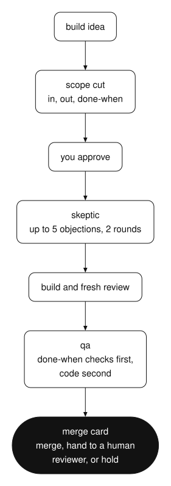

[home](../../README.md) / [operate](../README.md)

# a bot staff works when every bot has one job and you still say yes

you can run your bots two ways. one chat window for everything, or agents that run the company while you sleep. i run neither. mine work like a small team. every person has one job, a notebook and a boss who says yes before anything leaves the building.

i got there by counting. i run [ellora](https://getellora.com) with a small staff of bots, and i wanted to grow without hiring. so i audited it. my bots ran 289 to 315 routines a week. only 14 of them touched my company. the rest went to x, sports and a writer bot.

i got 18 chat reports a day, mostly at times i couldn't act on them. the bots wrote 12 audit pages and shipped 0 fixes.

## one job, one record, one yes

i rebuilt around three rules.

1. every bot owns one job end to end.
2. all work gets written to one shared place. if it isn't there, it didn't happen.
3. nothing goes outside without the owner's yes.

each bot gets a written job, its own memory and only the connections its job needs. a money bot reads the inbox but can't pay. an outreach bot drafts emails but can't send them.



*a chief of staff routes requests to single-job bots. the bots hand off to each other, write to one shared record and send everything outward through you.*

## the process

1. **audit first.** list every routine and count what each one touches. cut what touches nothing you own.
2. **write one job sheet per bot.** the job, what it never does, who it hands off to and when it speaks to you.
3. **pick one shared record.** every bot logs there, and you check claims against it.
4. **wire direct handoffs.** a bot that finds a problem tells the bot that owns the fix.
5. **add a chief of staff.** it routes each request to the bot that owns it and passes new rules on.
6. **run a weekly stand-up.** each bot posts done, blocked and needs from you. a cleanup pass then trims each bot's saved context.
7. **gate every build.** a scope cut, a skeptic, a qa pass and a merge card.
8. **fix mistakes in the record.** keep the old text and add a dated note.

## the gates

a build starts with a dated scope cut. it says what is in, what is out and what done looks like. you approve it. then a skeptic reads the plan for a new feature and argues against it, with up to 5 numbered objections. each needs evidence and says what would change its mind. it gets 2 rounds, then the builder decides.

after the build, qa tests against the done-when checks before it reads any code. then the owner sends you a merge card: merge, send to a human reviewer or hold. one word is enough.



*a build passes a scope cut, a skeptic, a qa pass and a merge card. the human sees one card at the end.*

in my staff, qa found that a change broke a members page on wide screens. a 49px sideways scroll hid the remove button. the fix went live and qa rechecked it at every width. then qa tried a sign-in date from the previous year. the card still ran 23px past the edge at 1024px. that would have hit every member once the year turned.

## the mistakes live in the record

in the first days some bots got facts wrong. one called page order a ranking. the list wasn't ranked. every error got fixed in the shared record, with the old text kept and a dated note. "never invent a fact" has to be a rule.

## keep it in one place

handoffs break when the work lives in two places. i moved the whole staff onto one platform, so a bot's finding reaches the next bot where it already works. the best handoffs are the boring ones. each bot knows who owns the next step.

i still spend about 2 hours a day on this, mostly saying yes or no. payments, deletes and publishing wait for me.

## install the skill

i turned this into a skill. give it your list of bots or routines. it counts what each one touches, then drafts the job sheets, the routing, the gates and the stand-up. it never creates a bot, never grants a connection and never sends anything outside. it writes the design, and you decide what to build. install it in claude code with the two commands below, or paste the prompt into any agent that reads skills.

**claude code**

```text
/plugin marketplace add shashank-sn/workflows
/plugin install bot-staff@shashank-workflows
```

**any other agent**: paste this prompt.

```text
install the agent skill at https://github.com/shashank-sn/workflows/tree/main/operate/bot-staff/skills/bot-staff
copy that whole folder into your skills directory (for claude code: ~/.claude/skills/bot-staff), read its SKILL.md, and use it on: <your task>
```

[read the skill files](skills/bot-staff/SKILL.md) · [ask a question](https://github.com/shashank-sn/workflows/issues/new?title=bot-staff) · [all operate workflows](../README.md) · [home](../../README.md)
