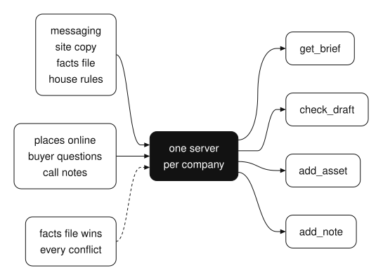
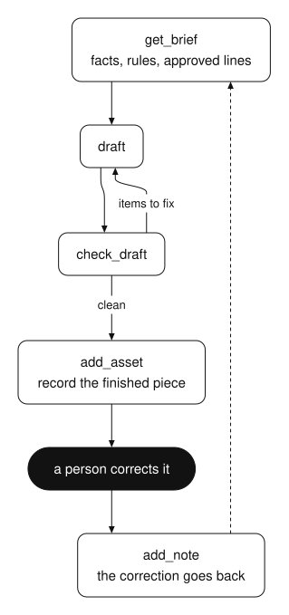

[home](../../README.md) / [operate](../README.md)

# a writer who pulls facts from memory will publish a wrong number

i write for several companies at once. each one has its own facts, its own banned phrases and its own approved sentences. the failure i kept seeing was never bad prose. it was a good sentence with a wrong fact inside it.

the fact came from memory, an old deck or a doc nobody had updated. the writer wasn't careless. the writer had no single place to look.

so i give each company one server that holds everything known about its marketing. you run the same loop against it as every other writer, human or agent.

## what the server holds

seven things, kept in one place per company:

- the approved messaging, word for word.
- a daily copy of the company's website, so the writer sees the page as it reads today.
- a facts file. every row has a status: settled, approved, held or never-say.
- the house rules for how this company writes.
- the places the company lives online and what each one says today.
- the questions buyers ask.
- notes from calls.

the facts file is the part that earns its keep. a settled row is a fact you can use. an approved row is a sentence you use in its exact words. a held row is blocked, and its conditions say what to write instead. a never-say row is a phrase that stays out. when two sources disagree, i go with the row in the facts file. nobody on the team argues it again in a draft.



*one server per company holds seven kinds of knowledge. writers reach it through four calls, and the facts file wins every conflict.*

## the loop

every piece, from a bio to a post to a reply, goes through the same four steps.

1. `get_brief` returns the facts, the rules and the approved lines that fit this piece.
2. you draft.
3. `check_draft` compares the draft to the facts file and the house rules.
4. `add_asset` records the finished piece, so the next writer sees it exists.

one more call, `add_note`, carries a correction back. when a person fixes a draft, the fix goes into the server in their own words. the next writer sees it.



*every writer runs the same loop. when a person corrects a piece, the correction goes back into the server.*

## the process

1. **gather the sources.** collect the messaging, the site, the decks, the call notes and the rules. note where each one came from.
2. **write the facts file first.** one row per fact, with a status and the exact words. send every conflict to the person who owns the answer. do not guess.
3. **copy the website every day.** a scheduled job saves each page and a dated log of what changed.
4. **load the rest.** add the house rules, the places online, the buyer questions and the call notes.
5. **expose the tools.** search and fetch to read. the four loop calls to write. a brief tool and a check tool are the two that matter most.
6. **make the rule plain.** a writer does not take a fact from memory or an old doc. a writer asks the server.
7. **run the loop on a real piece.** check that a wrong number gets caught.
8. **route corrections back.** every correction becomes a note. a person reads the notes each week and promotes the good ones into the rules or the facts file.
9. **protect the data.** strip people's emails and phone numbers when you index call notes.

## what it doesn't do

it doesn't make a writer good. it makes a writer's facts checkable. a draft can pass `check_draft` and still be dull. you still read it.

it also doesn't hide a conflict. if two sources disagree and nobody has ruled, the row stays held. the server says so, and the writer writes around it.

i keep one server per company. a shared one leaks one company's facts into another's copy. the method is shared. the facts never are.

## install the skill

i turned this into a skill. give it a company's sources and it builds the facts file, the site copy job, the house rules and the four-call loop, and runs the loop on one test piece. it asks the owner of a fact before it settles a conflict. it never invents a fact, never mixes two companies' material, and never keeps a person's contact details. install it in claude code with the two commands below, or paste the prompt into any agent that reads skills.

**claude code**

```text
/plugin marketplace add shashank-sn/workflows
/plugin install client-facts-mcp@shashank-workflows
```

**any other agent**: paste this prompt.

```text
install the agent skill at https://github.com/shashank-sn/workflows/tree/main/operate/client-facts-mcp/skills/client-facts-mcp
copy that whole folder into your skills directory (for claude code: ~/.claude/skills/client-facts-mcp), read its SKILL.md, and use it on: <your task>
```

[read the skill files](skills/client-facts-mcp/SKILL.md) · [ask a question](https://github.com/shashank-sn/workflows/issues/new?title=client-facts-mcp) · [all operate workflows](../README.md) · [home](../../README.md)
