[home](../../README.md) / [presence](../README.md)

# an audit nobody acts on is wasted, so hand over the changes

a good audit ends in a report. the founders read it, nod, and nothing on the live page changes.

you've seen this happen, and so have i. the audit was right. it found the empty description, the test image at the top of the list and the stale readme. then it landed as a document full of findings, and findings are not work. somebody still has to decide what to type, where to type it and how to tell it took.

that somebody is usually a founder with ten minutes. so the audit dies in a tab.

the fix is to stop handing over findings and start handing over changes. you do the thinking once, write it down, and give each reader only the part that needs them.

## three files, three readers

this step comes after [the presence map](../presence-map/README.md). the map finds the places and audits them. this step takes one audited place and writes three files.

- **the full channel page** is the record. it holds who reads the place, the best examples, what the company has there today, every change with its reason, the decisions, and how you'll know it worked. the person doing the work and anyone checking it read this one.
- **the founders' changes page** is the work. each change sits under the place where it happens. it has the exact text to paste, the page to open, who does it and how to tell it worked.
- **the appendix** is the proof. it has before and after views, the best examples, and what ai assistants say about the company today. a founder opens it when they doubt a change.



*you write the full page first. the other two files are copied from it, so a paste is written once.*

the founder gets only what needs their hands. the reasoning stays on the full page. a change that needs no founder still shows up, with the name of the role that does it, so nobody wonders.

## the process

1. **take the audit in.** read the findings and the drafted text for one place. stop if the audit has no source for a drafted line.
2. **read the live place again, signed out.** quote what is there today and date the read. the page may have changed since the audit.
3. **write the full channel page.** top lines, decisions, to-dos, before and after, the changes, strategy, who reads it, the best examples, today in detail, how you'll know it worked, open items, sources.
4. **turn each finding into one change.** one type, one doer, one page to open, the exact paste, a reason, and a done-when line.
5. **group the changes by where they happen.** one group per screen, repo or file. never group by person.
6. **keep decisions short.** a decision goes to a founder only when the company's sources cannot settle it. each one carries your recommendation.
7. **copy the founders' page from the full page.** copy every paste byte for byte. if a paste is wrong, fix the full page and copy again.
8. **write the appendix.** before and after views, examples, what assistants say today, and what you left alone.
9. **check every file.** pastes match, numbers have sources, every link opens, no internal words reach a founder.
10. **get a cold read.** someone with no context reads the founders' page as the founder would, and lists what they could not do.
11. **hand over the paths.** list what you could not confirm. do not publish.

## what a change looks like

each change is a card with the same parts. where to go, who does it, the text to paste, why, and how to tell it worked. a card without a paste or a done-when line is not ready.



*every change has the same parts. if one is missing, the card is not ready to hand over.*

one card has one doer and one method. "you paste this into the description field" and "we make this change once you send the invite" are both fine. a card that says both is two cards.

## the rules i hold

- **paste once.** the text lives on the full page, and the founders' page copies it. nobody retypes a paste, because a retyped paste drifts.
- **no decision a source can settle.** if the company's own facts answer the question, use the answer. ask a founder only about what is truly open.
- **no hedging on the founders' page.** the full page holds the honest case, including "this is low priority". the founders' page shows priority by order.
- **the files never publish.** the skill never signs in, posts or sends. a person with access makes each change after the founders agree.

## install the skill

i wrote this up as a skill. give it one audited place and the company's sources, and it writes the three files and a list of what it could not confirm. it writes files only. it never signs in, posts, sends or submits, and it never invents a fact, a number or a command to fill a gap. install it in claude code with the two commands below, or paste the prompt into any agent that reads skills.

**claude code**

```text
/plugin marketplace add shashank-sn/workflows
/plugin install changes-page@shashank-workflows
```

**any other agent**: paste this prompt.

```text
install the agent skill at https://github.com/shashank-sn/workflows/tree/main/presence/changes-page/skills/changes-page
copy that whole folder into your skills directory (for claude code: ~/.claude/skills/changes-page), read its SKILL.md, and use it on: <your task>
```

[read the skill files](skills/changes-page/SKILL.md) · [ask a question](https://github.com/shashank-sn/workflows/issues/new?title=changes-page) · [all presence workflows](../README.md) · [home](../../README.md)
