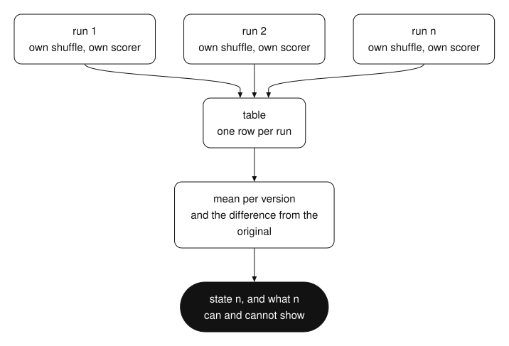

[home](../../README.md) / [research](../README.md)

# if the scorer knows which text is the edit, the score is not a score

if the scorer knows which text is the edit, the score is not a score.

did this edit make the text better? the usual check is to put the original next to the edit and ask a model or a tool to judge them. that check is weak. the judge sees a label, and the label leaks. "edited" reads as "improved", and nobody has to mean it.

so i hide the label. the scorer gets neutral files and never sees which one is which.

## the setup

each run has one source text and its versions: the original, edit a and edit b. a small script copies them to files named x, y and z in random order. the label-to-version map goes in a key file the scorer never sees. one fixed rubric scores every file.



*the scorer sees only neutral labels. the key stays behind a wall until scoring ends.*

## the process

1. **name the versions.** the original, and each edit you want to judge.
2. **fix the rubric before you look at any text.** one checklist, one tool or one fixed prompt.
3. **collect several runs.** each run is a separate source text with all its versions.
4. **shuffle each run alone.** neutral labels, random order, a fresh shuffle every time. write the key to its own file.
5. **score with a fresh scorer per run.** it gets the labelled files and the rubric. it does not get the key, the file names or what the edits were.
6. **reveal after scoring.** join the scores to the key.
7. **report per run and the mean.** show every row, not only the average.
8. **state n and its limits.** say what this sample can show and what it cannot.

## a worked case

i used this on my own company's product. ellora is a writing review loop. i wanted to know whether it makes ai-written blog posts score as more human on a public ai-writing detector. a higher score means more human.

sonnet wrote five blog drafts of 650 to 800 words with no style guidance. each draft became two edited versions. arm a fixed the red and yellow findings and stopped where ellora said to stop. arm b also fixed the blue findings. each run's three versions were shuffled to x, y and z. one fresh sonnet scorer per run applied the detector's skill file and ran its script.

| run | original | arm a | arm b |
|---|---|---|---|
| 1 | 56 | 61 | 66 |
| 2 | 54 | 57 | 62 |
| 3 | 70 | 76 | 76 |
| 4 | 88 | 91 | 96 |
| 5 | 67 | 70 | 75 |
| mean | 67 | 71 | 75 |

the mean gain was +4 for arm a and +8 for arm b. both arms scored at or above the original in all five runs. arm b matched arm a in one run and beat it in the other four.



*each run gets its own shuffle and its own scorer. the report shows every run, the mean and the sample size.*

## what five runs can and cannot show

five is small. the numbers support these points and no more.

- they show a consistent direction on these five drafts. no run went down.
- they do not show a general effect. these are five drafts from one model, scored once each by one scorer, on one detector.
- scorers vary. a gap of three points equals about one detected pattern, so treat a gap that small as noise.
- the gain in arm a was mostly cosmetic. in three of five runs the only change was lowercasing, and the detector stopped deducting for title-case headings.
- a heavier rewrite could add new tells. this test did not cover it.

blind scoring did not make the result bigger. it made it believable, because nobody knew which file was the edit.

## where it fits

blinding fixes who knows what. it does not fix what you measure. if your rubric changes between runs, you have two measurements. the [measurement protocol](../measurement-protocol/README.md) covers that side. use both.

## install the skill

i turned this into a skill. give it the versions of each text and a rubric. it shuffles each run, keeps the key apart, briefs a fresh scorer per run, reveals scores after scoring and writes the per-run table, the mean and a plain statement of n. it never shows the scorer the key, never rescores a text because the number looks wrong and never claims more than the sample supports. install it in claude code with the two commands below, or paste the prompt into any agent that reads skills.

**claude code**

```text
/plugin marketplace add shashank-sn/workflows
/plugin install blind-scoring@shashank-workflows
```

**any other agent**: paste this prompt.

```text
install the agent skill at https://github.com/shashank-sn/workflows/tree/main/research/blind-scoring/skills/blind-scoring
copy that whole folder into your skills directory (for claude code: ~/.claude/skills/blind-scoring), read its SKILL.md, and use it on: <your task>
```

[read the skill files](skills/blind-scoring/SKILL.md) · [ask a question](https://github.com/shashank-sn/workflows/issues/new?title=blind-scoring) · [all research workflows](../README.md) · [home](../../README.md)
