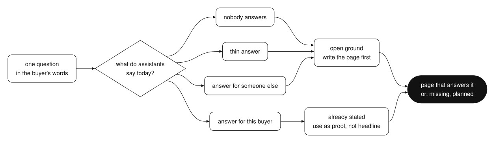

[home](../../README.md) / [research](../README.md)

# a question set you brainstormed measures your team, not your buyers

a question set that a team brainstormed in a room measures the team.

you have probably seen this happen. someone opens a doc and writes forty questions about the category. they sound right. they use the company's own words. then the measurement runs, and the answers come back full of the company's own words. nobody asked a buyer anything.

this is the step that comes before [the measurement protocol](../measurement-protocol/README.md). that one decides how to count. this one decides what to count.

## start from what buyers said out loud

the best source is a recorded sales call. a buyer on a discovery call says what they are stuck on, in their own register, with no marketing in the way. a team's brainstorm can't match that.

recorders mislabel who is speaking, in both directions. so i split each call into numbered turns and judge every speaker from what is said. i keep quotes only from buyer turns. the vendor's own people are never askers.

if you have no calls, say so in the file. every question is then a hypothesis about the buyer, and you label the set that way.

## the process

1. name the buyer and the moment that makes them start asking. tag every item as that moment, a pain that grows in it, or generic.
2. read the buyer calls first. keep buyer turns only.
3. pool every question with an id, a source and a verbatim quote that a script can find in the saved source.
4. grade each question by independent askers. two or more outside the vendor side is confirmed. one is a hypothesis. none is tool-only.
5. rewrite each question in the asker's words, without the company's name.
6. ask assistants and a search engine each question and mark what they say today.
7. have a reviewer who did not write the rows check the set.
8. tag every question by persona, role and segment, read the counts, then freeze.
9. write the answer map and the coverage map.
10. hand the frozen set to the measurement.



*buyer calls feed one pool. four checks decide which questions are measured and which are only answered.*

## check what assistants already answer

before you decide what to measure, find out where the answers already exist. ask each question to several assistants and to a search engine, signed out. never name the company in the prompt.

you will put each answer into one of four groups: nobody answers it, the answer is thin, the answer is for someone else (another company size, say), or the answer is exactly for your buyer.

the first three are open ground. write those pages first. the fourth is a warning. if two assistants already say what your position says, that claim is stated. use it as proof inside a page, not as the headline.

## have someone else check it

the person who wrote the rows is the worst person to check them. a reviewer with a fresh context reads the set. it looks for invented detail, the wrong register, questions merged that ask different things, and rows that name the company. fix what it finds before you freeze.

## freeze, and keep two lists

before the freeze, tag every question by persona, role and segment and read the counts. a set that leans toward one segment is a blind spot. state it or collect more.

then freeze. the frozen file is never edited. any change is a new dated file. if more than ten percent of the questions change, that is a new baseline, not a trend.

but measuring is not the same as answering. the frozen set is a sample you read. the answer map is every question worth writing for. you route each leftover question to answer, pool or drop. pool means measure later, in a small dated batch. drop is for duplicates and for people who will never buy or influence the buyer.

## the coverage map

the last file has one row per question. its mark from the gap check, who answers it today, the page that answers it, and the wave it ships in. a page that does not exist is marked missing or planned.

never widen a page to fit one question. name a new page that links to it.



*each question gets a mark from the assistants and a page that answers it. open ground gets written first.*

## install the skill

i turned this into a skill. give it the company, the buyer and any calls you have. it builds the pool, runs the gap check, asks for the independent review, freezes the set and writes both maps. it never quotes a source it can't find, never lets an assistant raise a question's grade, and never edits a frozen file. install it in claude code with the two commands below, or paste the prompt into any agent that reads skills.

**claude code**

```text
/plugin marketplace add shashank-sn/workflows
/plugin install buyer-questions@shashank-workflows
```

**any other agent**: paste this prompt.

```text
install the agent skill at https://github.com/shashank-sn/workflows/tree/main/research/buyer-questions/skills/buyer-questions
copy that whole folder into your skills directory (for claude code: ~/.claude/skills/buyer-questions), read its SKILL.md, and use it on: <your task>
```

[read the skill files](skills/buyer-questions/SKILL.md) · [ask a question](https://github.com/shashank-sn/workflows/issues/new?title=buyer-questions) · [all research workflows](../README.md) · [home](../../README.md)
