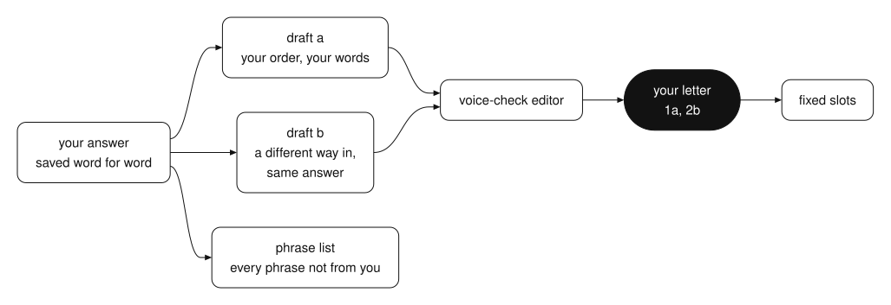
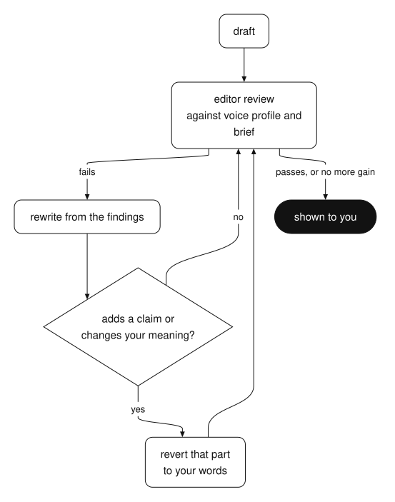

[home](../../README.md) / [write](../README.md)

# ai can post for you every day, but only your answers can be the post

the problem with writing with ai isn't the ai. it's having no original thought to hand it.

i did design, brand and content strategy for almost 8 years. every idea in my head needed someone else to make it. now ai asks, drafts and schedules. the thought behind every post is still mine, and so is the yes.

this is the setup i run on [@istupidpreneur](https://x.com/istupidpreneur). you can run the same steps with any chat tool, editor and scheduler.

## the questions come first

every morning a bot asks me up to 3 questions. they are about what founders, builders and ai people are arguing about right now. each question links its source post.

a question asks for my sharp opinion on one live debate and the experience behind it. it never asks what i think in general.

a post can only be as good as the answer, so you spend your care on the questions.

## the answer is the spine

i answer by voice. my answers ramble, restart and repeat. that's fine, because the answer is the spine of the post. if i didn't say a take, an example or a number, it doesn't go in the draft.

## two drafts and a list

each answer becomes two drafts and a list.

- one draft keeps my order and my words.
- one draft enters from a different point in the same answer, like my number first or my quoted line first.
- the list holds every phrase that isn't from my answer, so i can cut it.



*each answer becomes two drafts and a list. only the draft that passes the editor and gets my letter reaches the schedule.*

## the process

1. **ask.** the bot sends up to 3 questions about live debates, each with its source linked.
2. **answer.** i reply in my own words, by voice if i like. the bot saves each answer exactly as i said it.
3. **draft.** the bot writes two drafts per answer plus the list of phrases that aren't mine.
4. **check the voice.** every draft goes to a voice-check editor before i see it. i use [ellora](https://getellora.com), my own editor. any editor that checks a draft against a voice profile works. the [voice profile workflow](../voice-profile/README.md) shows how to build one.
5. **loop.** if the draft fails, it goes back with fixes, gets rewritten and is checked again until it passes.
6. **protect my words.** if a rewrite adds a claim or changes what i meant, that part goes back to my words. my words win over the score.
7. **approve by letter.** i get the drafts labelled 1a, 1b, 2a and so on. i reply with the ones i want, and you can do the same.
8. **fix typos only.** after approval the bot may fix typos. it names each fix as old to new.
9. **schedule.** approved posts go into fixed daily slots. mine are 10.30am, 3.30pm and 8.30pm ist, whichever is free next.

nothing gets scheduled without my letter for that exact draft.

## what the editor is for

the editor reviews the finished draft, not the prompt. it checks the draft against a voice profile and a writing brief for the account. voice isn't a feeling. it's habits you can count.

a rewrite can sound more like me and say something i never said. that is why step 6 exists.



*the editor loop runs until the draft passes. a rewrite that adds a claim goes back to my words before the draft reaches me.*

## what i still do by hand

- every reply, and answering the top replies on posts that do well.
- some native posts, like my moat quote.
- every like, follow and dm.
- signing off on any rule or skill change.

the bot never touches those.

## what changed

before this setup i posted through a scheduler. 317 posts since jun 24 landed at a median of 123 impressions. on oct 15 i cut the trend monitor, the reply hit lists and the link prompts, and kept only the questions that lead to original content. the setup in this post has run since oct 22.

two recent posts were quotes with a hook. the moat quote, which i posted by hand, got 1,247 views at 4.2% engagement. the tony stark quote got 558 views. my originals with no hook stayed under 150.

the setup also flagged a scheduled post that had no source in my answers.

## install the skill

i turned this into a skill. give it a source for live debates, a voice profile or brief, a place to store drafts and a scheduler. each day it asks the questions, saves your answers, writes two drafts and the phrase list, runs the editor loop and waits for your letter. it never schedules a draft without the letter for that exact draft. it never invents a take, a fact or a number, and it never replies, likes, follows or sends a dm. install it in claude code with the two commands below, or paste the prompt into any agent that reads skills.

**claude code**

```text
/plugin marketplace add shashank-sn/workflows
/plugin install daily-posts@shashank-workflows
```

**any other agent**: paste this prompt.

```text
install the agent skill at https://github.com/shashank-sn/workflows/tree/main/write/daily-posts/skills/daily-posts
copy that whole folder into your skills directory (for claude code: ~/.claude/skills/daily-posts), read its SKILL.md, and use it on: <your task>
```

[read the skill files](skills/daily-posts/SKILL.md) · [ask a question](https://github.com/shashank-sn/workflows/issues/new?title=daily-posts) · [all write workflows](../README.md) · [home](../../README.md)
