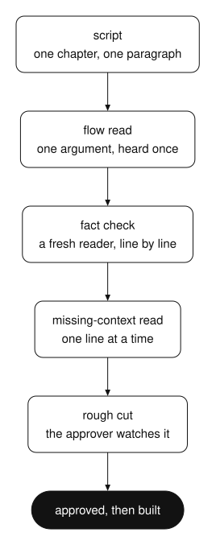
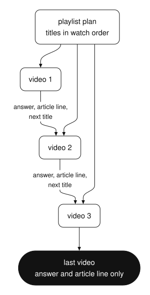

[home](../../README.md) / [write](../README.md)

# a video script that reads well can still fail when it is heard

you can write a video script that reads well and still fails the first time someone hears it.

i've written product videos that passed every check i had. then i played one aloud and it fell apart. the sentences were all correct. they just didn't lead to each other. a reader can scroll back. a listener can't.

so i changed what the script is written for. it is written to be heard, once, by someone who knows only the title and the company.

## one argument, not a list of true sentences

a good video is one line of thought. each chapter answers a question the last one raised. the viewer never has to wonder why a point is coming now.

that means a few habits. i write each chapter as one paragraph before i cut it into rows, so every sentence follows the one before. i ask each chapter's question aloud and answer it in a full sentence. i never say "first" or "second", because nobody tracks the count. and after every event in the story, i say what it means before anyone acts on it.

the story uses "you" in a role the viewer can step into. never a named person.

## the checks run on a fresh reader

the writer is the worst judge of the script. so every check goes to someone who didn't write it.



*the script goes through three of the checks in order, then to a rough cut the approver watches. the approver's yes comes before anything is built.*

the one that surprised me most is the missing-context read. a fresh reader plays the viewer and reads one line at a time, never ahead. it flags words that point at something it can't place, phrases it has to stop and unpack, and sentences nobody would say out loud. a script that passed every other check still came back covered in flags. every new reader finds new ones. i don't chase the count. i fix what changes the listen.

## the process

1. **write the brief on one page.** the viewer by role, the one idea, the short answer with an example for each condition, and the story. if the one idea is only a topic, stop.
2. **build the question chain.** the viewer's question at each point, what answers it, and the question that answer raises.
3. **write each chapter as a paragraph, then cut it into rows.** each row holds a picture, the narration, the word the picture changes on, on-screen words and a source.
4. **close the same way every time.** the answer to the title, a fixed article line, then the next title.
5. **run the checks in order.** flow read, fact check, missing-context read, a cut of detours, then a second fact check on every changed row.
6. **write the packaging before anyone reviews.** title, description, chapters, tags and thumbnail idea.
7. **make a rough cut.** voice the exact current script and show it to the approver as audio or video.
8. **write the handover for the builder.** the script, the picture notes, the packaging and how to say the hard words.
9. **check the playlist.** when every video exists, one fresh reader looks for repeats and contradictions.

## show the approver a rough cut, not a document

a script on a page is judged by how it looks on a page. so the approver doesn't get the page. the approver gets the rough cut, with the packaging beside it, and one line saying what to watch and how long it takes.

this was the biggest change. it moved the real review from how the script reads to how it works when you hear it. a video is heard, so that is the test that predicts what a viewer will do.

## hand the builder a complete package

one file gives the builder the script, the packaging and the shot notes. i write the packaging before the review, not after the approver asks for it. the question chain and the fact notes stay in a section the builder doesn't see. the builder needs the words and the pictures. the reasoning is ours.

## a playlist follows one standard

one video is easy to get right. the work is making many of them agree. every video in a playlist ends with its answer, one fixed article line, and the next title.



*every video closes with its answer, the article line and the next title. the last video leaves out the next title.*

i built this method across several companies' playlists. it works because the standard lives in one place. when the method sits in several copies, a fix in one never reaches the others. so there is one copy of the method. what differs by company is its own folder.

## install the skill

i turned this into a skill. give it a title, the viewer, your sources and the playlist plan. it writes the brief, the question chain, the script, the packaging and the handover, and runs the checks in order. it never writes a fact from memory, never sends anything to a client, and never treats a passed check as the approver's yes. install it in claude code with the two commands below, or paste the prompt into any agent that reads skills.

**claude code**

```text
/plugin marketplace add shashank-sn/workflows
/plugin install video-script@shashank-workflows
```

**any other agent**: paste this prompt.

```text
install the agent skill at https://github.com/shashank-sn/workflows/tree/main/write/video-script/skills/video-script
copy that whole folder into your skills directory (for claude code: ~/.claude/skills/video-script), read its SKILL.md, and use it on: <your task>
```

[read the skill files](skills/video-script/SKILL.md) · [ask a question](https://github.com/shashank-sn/workflows/issues/new?title=video-script) · [all write workflows](../README.md) · [home](../../README.md)
